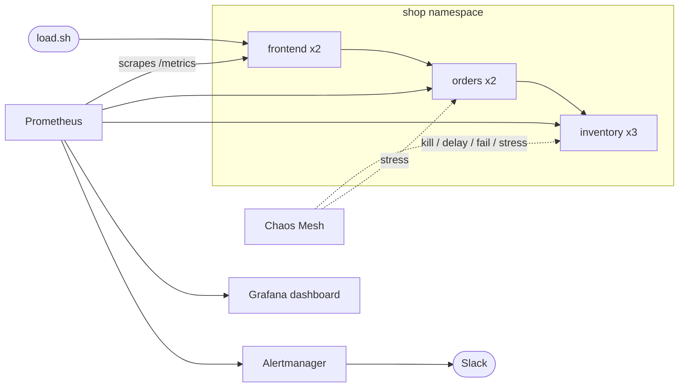

# Chaos Lab

Break a Kubernetes app on purpose and watch it recover.

A small three-service shop runs on a local Kubernetes cluster. [Chaos Mesh](https://chaos-mesh.org) kills pods, injects network latency, takes services down and burns CPU. Prometheus and Grafana show the impact live, and Alertmanager sends Slack alerts when things go wrong and again when they recover. Terraform builds the whole platform, and GitHub Actions tests it, scans the image and runs a resilience gate on every pull request.

**Stack:** Terraform · Docker · Kubernetes (kind) · GitHub Actions · Chaos Mesh · Prometheus · Grafana · Alertmanager · Slack

## Architecture



All three services are one Python image (Flask + Gunicorn). The `SERVICE` env var picks the role. A `/checkout` request goes frontend → orders → inventory. Each hop has a 2s timeout and one retry, and every service exposes `/healthz` and Prometheus `/metrics`.

## Prerequisites

- Docker
- [kind](https://kind.sigs.k8s.io), [kubectl](https://kubernetes.io/docs/tasks/tools/), [Terraform](https://developer.hashicorp.com/terraform/install) 1.5+
- `make`
- About 6 GB of free RAM
- A Slack [incoming webhook](https://api.slack.com/messaging/webhooks) (optional, for alerts)

## Quick start

```bash
cp terraform/terraform.tfvars.example terraform/terraform.tfvars
# edit it: set slack_webhook_url and grafana_admin_password

make up        # kind cluster + Chaos Mesh + Prometheus/Grafana/Alertmanager (about 5 min)
make deploy    # build image, load into kind, deploy the app, alerts and ServiceMonitor
```

Open three terminals:

```bash
make grafana   # http://localhost:3000   user: admin   dashboard: "Chaos Lab - Resilience"
make load      # steady traffic so the graphs have data
make chaos-outage
```

The `make` commands use the kubeconfig Terraform writes to `terraform/chaos-lab-kubeconfig`. To use `kubectl` directly: `export KUBECONFIG=$PWD/terraform/chaos-lab-kubeconfig`.

Run `make help` for every target.

## Experiments

| Command | What breaks | What you should see |
|---|---|---|
| `make chaos-kill` | One inventory pod is deleted | Available replicas dip, then recover within seconds. The retry in orders keeps errors near zero. |
| `make chaos-delay` | +800 ms latency on inventory for 3 min | p95 latency climbs past 500 ms and `CheckoutHighLatency` fires in Slack. Requests still succeed. |
| `make chaos-outage` | All inventory pods fail for 90 s | Checkout returns 502s. `CheckoutHighErrorRate`, `ReplicasUnavailable` and `ServiceDown` fire, then resolve after recovery. |
| `make chaos-cpu` | 90% CPU stress in one orders pod for 2 min | The pod is throttled by its 200m limit and latency rises. |
| `make gameday` | All of the above in sequence | A full ten-minute story on the dashboard. |
| `make chaos-stop` | | Removes every running experiment. |

Watch experiments in the Chaos Mesh UI with `make chaos-ui` (http://localhost:2333), or `make status` in a terminal.

## Alerts

Defined in `monitoring/alert-rules.yaml`:

| Alert | Fires when |
|---|---|
| `CheckoutHighErrorRate` | More than 5% of `/checkout` requests return 5xx for 30 s |
| `CheckoutHighLatency` | p95 `/checkout` latency above 500 ms for 30 s |
| `ReplicasUnavailable` | A deployment has fewer available replicas than desired for 30 s |
| `ServiceDown` | A deployment has zero available replicas for 15 s |

Alertmanager posts to `#chaos-alerts` with `send_resolved: true`, so you get a message when it breaks and another when it recovers. Change the channel in `monitoring/values-prometheus.yaml`. If you skip the webhook, alerts still show up in Alertmanager (`make alertmanager`).

## CI/CD

| Workflow | Trigger | What it does |
|---|---|---|
| `ci.yml` | push and PR | Unit tests, `terraform fmt` + `validate`, manifest validation with kubeconform, Docker build, Trivy scan, push to GHCR on `main` |
| `chaos-e2e.yml` | PR touching app/k8s/chaos, weekly, manual | Spins up a throwaway kind cluster, installs Chaos Mesh, deploys the app, kills a pod under load and fails if success rate drops below 85% or pods do not recover |

The e2e job is the interesting one: the pipeline itself proves the app is resilient before a change can merge. Tune the gate with `MIN_SUCCESS` and `DURATION` in `scripts/smoke.sh`.

Run `make fmt` before pushing so the Terraform format check passes.

## Repo layout

```
app/          Flask microservice, Dockerfile, unit tests
k8s/          Deployments, Services, namespace (kustomize)
chaos/        Chaos Mesh experiments + game-day workflow
monitoring/   Helm values, alert rules, ServiceMonitor, Grafana dashboard JSON
terraform/    kind cluster, Chaos Mesh, kube-prometheus-stack, dashboard ConfigMap
scripts/      load generator and CI resilience gate
.github/      CI and chaos-e2e workflows
Makefile      one-command workflows
```

## Troubleshooting

- **Chaos experiments do nothing:** check `kubectl -n chaos-mesh get pods`. The daemon must be running on every node and configured for containerd (Terraform does this).
- **No data in Grafana:** confirm `kubectl -n shop get servicemonitor` exists and the target is up at http://localhost:9090/targets (`make prometheus`).
- **Dashboard missing:** the sidecar can take a minute. Check `kubectl -n monitoring get cm -l grafana_dashboard=1`.
- **No Slack message:** verify the webhook with `curl -X POST -H 'Content-type: application/json' --data '{"text":"test"}' <url>`, then check `make alertmanager` for send errors.
- **`ImagePullBackOff` on the app:** run `make load-image`. kind cannot see images from your local Docker until they are loaded.

## Clean up

```bash
make chaos-stop
make down
```

## Ideas to extend it

- Add a HorizontalPodAutoscaler to frontend and watch it react to `make chaos-cpu`
- Add PodDisruptionBudgets and topology spread constraints, then re-run the outage
- Add a circuit breaker to the orders service and compare error ratios
- Move deploys to Argo CD (GitOps) and keep Chaos Mesh as the test harness
- Replace kind with a managed cluster (EKS/GKE) by swapping the Terraform cluster module

## What this demonstrates

- Infrastructure as code: a full platform from `terraform apply`
- Containerisation with a non-root, scanned image
- Kubernetes health probes, resource limits and replica-based resilience
- Observability: RED metrics, a Grafana dashboard and symptom-based alerts
- Chaos engineering: hypothesis, controlled failure, measured recovery
- CI/CD that gates merges on resilience, not just unit tests
